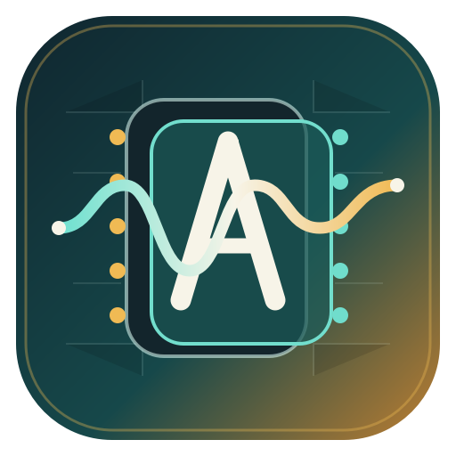
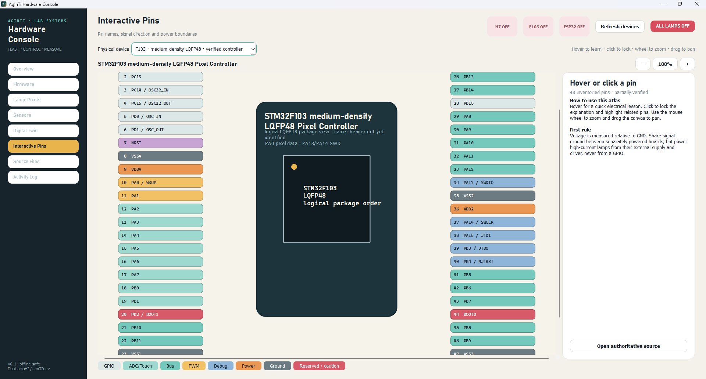

[English](README.md) · [العربية](i18n/README.ar.md) · [Español](i18n/README.es.md) · [Français](i18n/README.fr.md) · [日本語](i18n/README.ja.md) · [한국어](i18n/README.ko.md) · [Tiếng Việt](i18n/README.vi.md) · [中文 (简体)](i18n/README.zh-Hans.md) · [中文（繁體）](i18n/README.zh-Hant.md) · [Deutsch](i18n/README.de.md) · [Русский](i18n/README.ru.md)

[](https://lazying.art)

<p align="center">
  
</p>

<h1 align="center">AgInTi Hardware Console</h1>

<p align="center"><strong>A file-backed laboratory hardware digital twin and control workbench.</strong></p>

<p align="center">
  <a href="https://github.com/lachlanchen/AgInTi-HardwareConsole/releases"></a>
  <a href="LICENSE"></a>
  <a href="https://www.python.org/"></a>
  <a href="https://doc.qt.io/qtforpython-6/"></a>
  <a href="https://github.com/sponsors/lachlanchen"></a>
</p>



AgInTi Hardware Console turns laboratory controllers, pins, sensors, storage, firmware, telemetry, and control intents into one inspectable software mirror. It combines a LabVIEW-style workbench with a Git-friendly hardware filesystem: humans use the visual console while scripts and agents use structured JSON files.

## Why it exists

Laboratory hardware is usually fragmented across serial terminals, vendor flash tools, handwritten wiring notes, and one-off scripts. AgInTi Hardware Console creates one explicit model:

```text
physical board → device profile → live state → telemetry → safe control intent
                                      ↓
                         runtime/hardwarefs/devices/
```

The interface remains useful offline. Missing boards are shown as offline instead of being simulated as connected.

## Current capabilities

- Hardware Task Manager for CPU, execution contexts, RAM, Flash, NAND, QSPI, SD, and connection state.
- Interactive full-pin atlas with hover lessons, click-to-lock details, risk colors, zoom, and pan.
- STM32H743, STM32F103, and Waveshare ESP32-S3-DEV-KIT-N8R8 profiles.
- AS7343 spectrum, TSL2591 intensity, and dual INA219 power-monitor visualization.
- Safe dual-lamp PWM controls with timed operation, emergency OFF, and auditable intents.
- Build/flash profiles for ST-Link, OpenOCD, Arduino CLI, and ESP32 serial workflows.
- Source browser/editor for connected laboratory repositories.
- File-backed digital twin designed for human, script, and agent collaboration.

## Install on Windows

Download the portable ZIP from [Releases](https://github.com/lachlanchen/AgInTi-HardwareConsole/releases), extract it, and run `AgInTi-HardwareConsole.exe`.

To run from source:

```powershell
git clone https://github.com/lachlanchen/AgInTi-HardwareConsole.git
cd AgInTi-HardwareConsole
python -m venv .venv
.\.venv\Scripts\python.exe -m pip install -r requirements.txt
.\run.ps1
```

Create desktop and Start Menu shortcuts:

```powershell
.\scripts\build_icon.py
.\scripts\install_windows_app.ps1
```

## Workspace integration

The console automatically discovers sibling `DualLampHI` and `stm32dev` repositories. Override locations with `AGINTI_PROJECTS_ROOT`, `DUALLAMPHI_ROOT`, `STM32DEV_ROOT`, or copy `workspace.example.json` to:

```text
%APPDATA%\AgInTi-HardwareConsole\workspace.json
```

Use it inside another repository as a submodule:

```bash
git submodule add https://github.com/lachlanchen/AgInTi-HardwareConsole.git apps/hardware_console
git submodule update --init --recursive
```

## Hardware as files

Runtime state is materialized under the ignored `runtime/hardwarefs/` tree:

```text
devices/<id>/identity.json
devices/<id>/pins.json
devices/<id>/storage.json
devices/<id>/telemetry.json
devices/<id>/controls/desired.json
devices/<id>/controls/actual.json
intents/<intent-id>.json
events.jsonl
```

Files express state and intent. Arbitrary file content is never executed; control actions pass through a whitelist and hardware safety checks.

## Safety boundary

The application starts offline-safe and does not automatically flash firmware or energize lamps. Timed lamp controls are the default, closing the application requests all lamps OFF, and hold mode requires explicit confirmation. Always provide correct external power, current limiting, and a shared signal ground.

## Project links

- Website: [lazying.art](https://lazying.art)
- Research ecosystem: [DualLampHI](https://github.com/lachlanchen/DualLampHI)
- Issues: [AgInTi Hardware Console issues](https://github.com/lachlanchen/AgInTi-HardwareConsole/issues)
- Citation: [`CITATION.cff`](CITATION.cff)

## Support development

If this work helps your laboratory or research, sponsorship supports hardware adapters, calibration tools, documentation, and reproducible releases.

<!-- support:start -->
[](https://github.com/sponsors/lachlanchen)
[](https://chat.lazying.art/donate)
[](https://paypal.me/RongzhouChen)
[](https://buy.stripe.com/aFadR8gIaflgfQV6T4fw400)
<!-- support:end -->

## License

MIT © 2026 [Lachlan Chen](https://github.com/lachlanchen)
